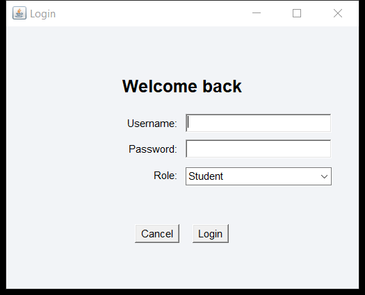
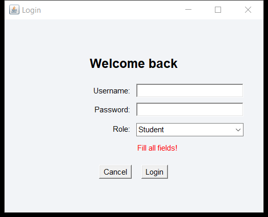
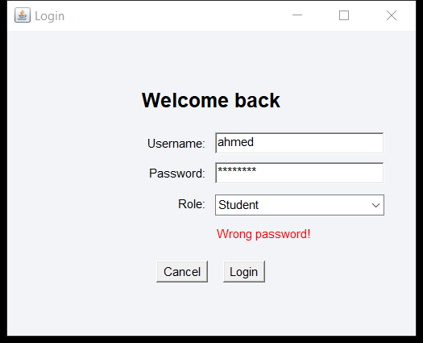
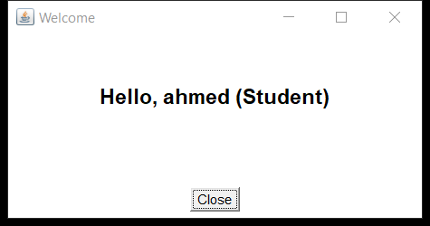

# Login Form Task

مشروع بسيط لشاشة تسجيل الدخول باستخدام Java AWT مع التحقق من صحة البيانات (Validations).

## بيانات المستخدمين المسجلين (Default Accounts)
| Role | Username | Password |
| :--- | :--- | :--- |
| **Student** | `ahmed` | `1234` |
| **TA** | `mona` | `ta123` |
| **Professor** | `dr_ali` | `prof123` |

---

## صور توضح تشغيل المشروع والـ Validations

### 1. شاشة تسجيل الدخول الأساسية


### 2. التحقق عند ترك الحقول فارغة (Empty Fields)


### 3. التحقق عند إدخال كلمة مرور غير صحيحة (Wrong Password)


### 4. شاشة الترحيب بعد تسجيل الدخول بنجاح (Welcome Page)


---

## طريقة التشغيل (How to run)
```bash
javac LoginFormTask.java
java LoginFormTask
```
